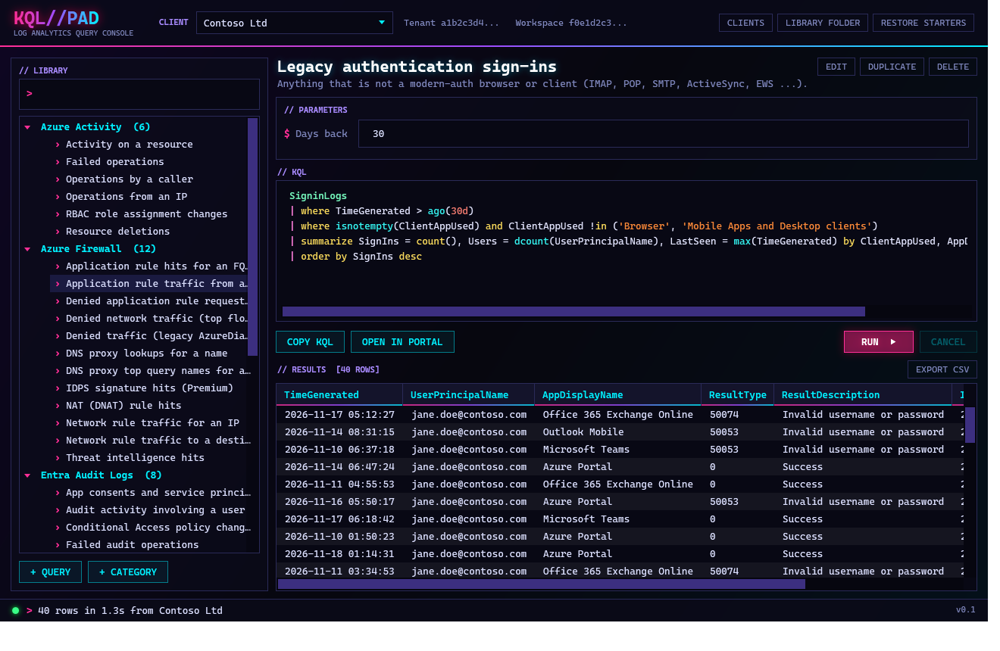
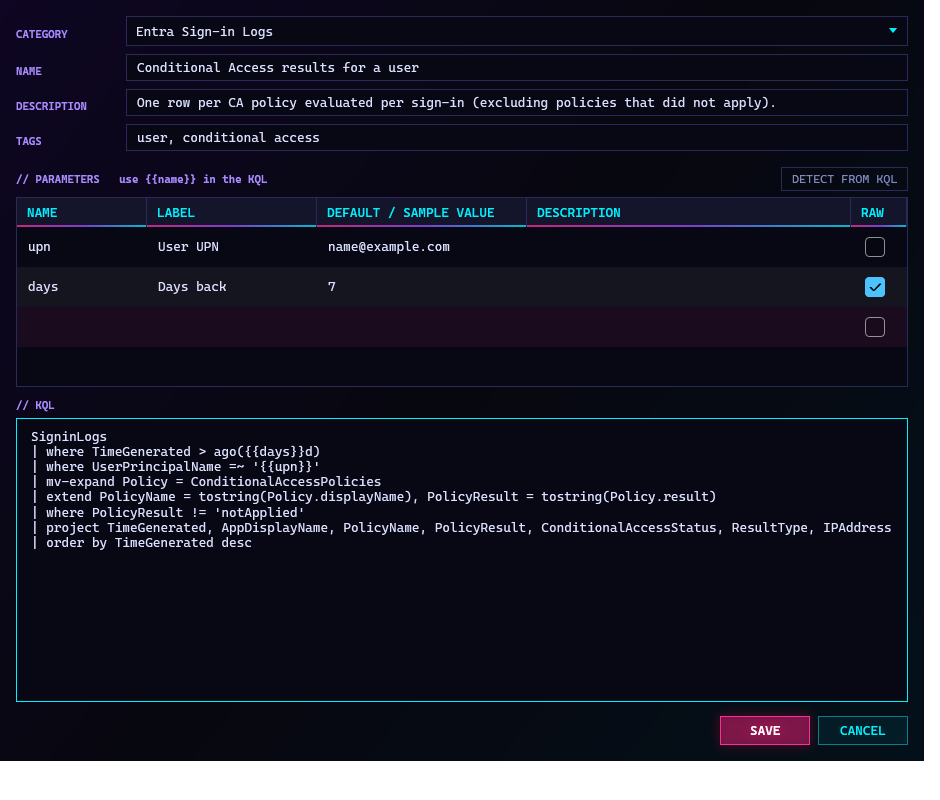

# KQL Pad

A Windows desktop app for keeping a library of reusable KQL queries and running them against the Azure Log Analytics workspaces of several clients or tenants. You don't need to open the Azure portal.



## Features

- **Query library.** Queries are grouped by category, and you can search by name, description, tag or KQL text. You can add, edit, duplicate, rename and delete queries and categories from the app.
- **Parameters.** Placeholders like `{{upn}}` or `{{days}}` become input fields. Values are escaped for KQL string literals, and a value you type carries over to other queries that use the same parameter.
- **Several clients.** Each client profile has its own tenant, workspace and sign-in. You can switch clients from a drop-down, and the app keeps each sign-in separate.
- **Results.** Results show in a grid with the row count and run time. You can cancel a long-running query and export the results to CSV.
- **Azure portal link.** This opens the current query in Log Analytics in the Azure portal, with the query already filled in.
- **Starter queries.** The app comes with ready-made queries for Azure Activity, Azure Firewall, Entra audit and sign-in logs, Windows security events, and workspace health and cost.



## Requirements

- Windows 10 or 11 (on Windows 11 the title bar is dark too)
- The [.NET 10 SDK](https://dotnet.microsoft.com/download) to build from source
- An account with **Log Analytics Reader** (or higher) on each workspace you want to query. Global Administrator in Entra ID does **not** give data access by itself.

## Getting started

1. Build and run the app (see below).
2. Click **CLIENTS** and add a client:
   | Field | Required | Notes |
   |---|---|---|
   | Name | yes | Display name |
   | Tenant ID | yes | Tenant GUID or a verified domain such as `contoso.onmicrosoft.com` |
   | Workspace ID | yes | The workspace's *Workspace ID* GUID from its Overview page, not the resource ID |
   | Workspace resource ID | no | The full ARM resource ID. You only need it for **OPEN IN PORTAL** |
   | Login hint | no | The account to pre-select at sign-in |
   | Client ID | no | Your own app registration, if the tenant blocks the default public client |
3. To check the setup, use **TEST SIGN-IN + QUERY**. Then pick a query, fill in its parameters and click **RUN**. The first run for each client opens a browser window to sign in. After that the sign-in is cached.

## Building

```powershell
cd KqlPad
dotnet run
```

To build a self-contained single-file exe:

```powershell
dotnet publish KqlPad -c Release -r win-x64 --self-contained -p:PublishSingleFile=true -o dist
```

## Where data is stored

Everything is under `%APPDATA%\KqlPad`:

| Path | Contents |
|---|---|
| `queries\*.json` | The query library, one file per category |
| `profiles.json` | Client profiles |
| `auth\` | Cached sign-in records, one per client |

On first run, the starter queries are copied into `queries\`. To add back starter queries you've deleted, use **RESTORE STARTERS**. It only adds what's missing and doesn't overwrite your edits.

## Query file format

The query files are plain JSON, so you can edit them by hand, keep them in git, or share them. KQL is stored as a list of lines so changes are easy to compare:

```json
{
  "category": "Workspace and Health",
  "description": "What is in the workspace and what it costs.",
  "queries": [
    {
      "id": "ws-ingestion-by-table",
      "name": "Billable ingestion by table",
      "description": "GB ingested per table.",
      "tags": ["cost"],
      "parameters": [
        { "name": "days", "label": "Days back", "default": "30", "raw": true }
      ],
      "kql": [
        "Usage",
        "| where TimeGenerated > ago({{days}}d)",
        "| where IsBillable == true",
        "| summarize GB = round(sum(Quantity) / 1000, 2) by DataType",
        "| order by GB desc"
      ]
    }
  ]
}
```

- Placeholders use `{{name}}`. Square brackets aren't used because they already mean something in KQL.
- By default, a value is escaped so it's safe inside `'...'` or `"..."`. Set `"raw": true` to insert a value exactly as typed, for numbers, lists or timespans.
- In the query editor, **DETECT FROM KQL** adds a parameter for each placeholder it finds in the KQL.

## Troubleshooting

- **HTTP 401 or 403 after signing in:** the account signed in but can't read the workspace's data. Give it Log Analytics Reader on the workspace or resource group. A Global Administrator can also turn on *Access management for Azure resources* in Entra ID.
- **Signed in as the wrong account, or a tenant changed:** under **CLIENTS**, use **FORGET SAVED SIGN-IN** for that client. Changing a client's tenant, client ID or login hint also resets its sign-in.
- **A query file doesn't load:** at startup the app lists each file it skipped and why. The other files still load.
